# Timepix4 VCU128 Readout Systems

This memo describes the design of the readout system for the single-chip Timepix4 systems, using the TP4’s Gigabit transmitters (as opposed to using TP4's slow control readout). The FPGA board employed is the VCU128.

There are two ASIC hardware designs:
- the **Single_ETU** board ("Matt's board"), schematic EAG-00233, with a single wire-bonded TP4 ASIC and an FMC connector, to plug directly into the VCU128.  Hardware design is here:https://github.com/rikraf/TP4_Single_ETU-board
- the **TP4_COMPACT** board set, with a single wire-bonded TP4 ASIC on a 62mm round board, an FMCplus board, and an optional flex PCB to join the two, usually exiting a vacuum enclosure. Hardware design is here: https://github.com/rikraf/TP4_compact_hardware

The VCU128 FMC-plus (560-pin) connector can accept either the FMC-plus on the TP4_COMPACT board, or the 400-pin FMC connector on the Single_ETU board.

There are four firmware designs:
-  **TP4_1GbE** which outputs raw data in UDP packets slowly over the VCU128’s 1GbE interface,  https://github.com/rikraf/TP4_1GbE.  This is mainly of legacy interest, or maybe for porting to a new FPGA board which only has a 1GbE interface someday.  Compiled under Vivado 2022.1
- **TP4_1CHIP_RAW_VCU128** which outputs raw data in  UDP packets at very high rate data over one 100GbE link. https://github.com/rikraf/TP4_1CHIP_RAW_VCU128.  Compiled under Vivado 2025.2
- **TP4_multipair_VCU128**, same as TP4_1CHIP_RAW_VCU128, but which can use from 2 to 16 input pairs from the TP4 chip https://github.com/rikraf/TP4_multipair_VCU128.  This design will ultimately replace TP4_1CHIP_RAW_VCU128 
- **TP4_1CHIP_CRUNCHED_VCU128** which outputs photon cluster centroids over one 100GbE link. https://github.com/rikraf/TP4_1CHIP_CRUNCHED_VCU128. Compiled under Vivado 2025.2

All systems use the 1GbE for control and housekeeping data.

## Contents

- [Hardware](#hardware)
- [Firmware design](#firmware-design)
  - [Slow Control Interface](#slow-control-interface)
  - [SimpleRx](#simplerx)
  - [100GbE system data handling](#100gbe-system-data-handling)
- [Data Formats](#data-formats)
  - [Science Data Format, 1GbE system](#science-data-format-1gbe-system)
  - [Science Data Format, 100GbE system](#science-data-format-100gbe-system)
- [“Crunched” data flow](#crunched-data-flow)
- [Fake Data Generator](#fake-data-generator)
- [MicroBlaze Software](#microblaze-software)
- [Setting up 100Gb NIC, etc.](#setting-up-100gb-nic-etc)
- [The > 1.28 Gb/s problem](#the--128-gbs-problem)
- [Known Bugs, issues](#known-bugs-issues)
- [Revision history](#revision-history)

## Hardware

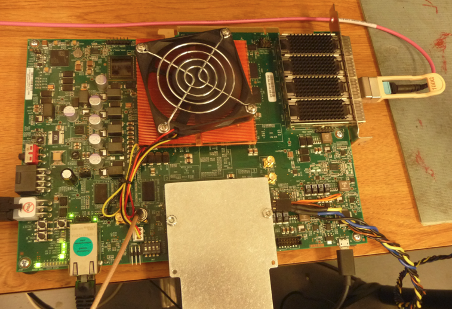

The photo shows the Single ETU board plugged into the VCU128 FPGA development board from Xilinx. 

### Single ETU Board 
For this board, we use two GWT pairs, one from the TP4 top and one from the bottom to read out the chip (eight are available from each half, though only a subset of those are available on this board, and a minimum of one is required from each half to read out the entire 448-by-512 pixel matrix):

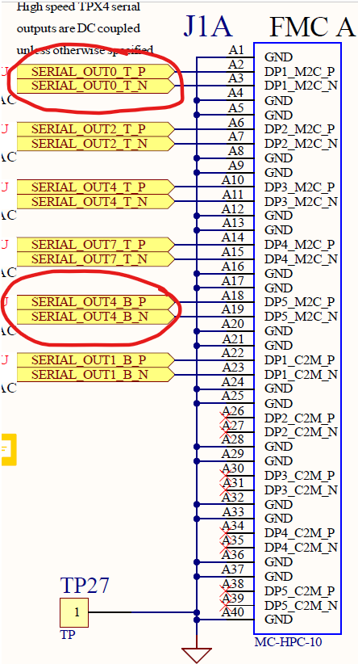


The VCU128 requires a modification to bring a reference clock to the FPGA bank where the Gigabit pairs are received. The programmable oscillator, U95, used to supply one QSFP cage on the VCU128 is connected to the MGTREFCLK0 input pair of bank 124 using a cobbled-on pair of wires (C1187/8 are removed):

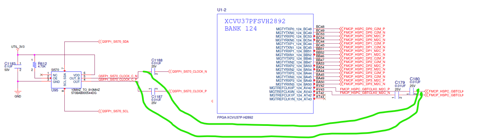

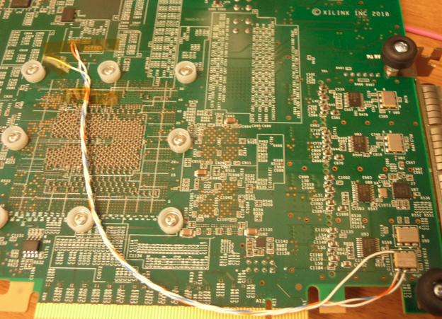

The oscillator U95 must be changed from its default power-on frequency of 156.25MHz to the necessary 160MHz using the “Board UI” program from Xilinx. This can be made non-volatile, so that the board powers up with this setting. The MGTREFCLK of bank 124 can also supply bank 125.

### TP4_COMPACT board set
All 16 available pairs are brought out of the ASIC.  The firmware can be compiled to accept ASIC data on from 2 to 16 high-speed pairs.  The 160MHz reference oscillator is incorporated into the board design, so the kluge described above is not necessary.  The pinout of the FMCplus connector is [here](https://github.com/rikraf/TP4_compact_hardware/blob/master/TP4_Compact_FMC%20PCB/fmc_fpga_PINOUT.xlsx).

# Firmware design

The firmware consists of a Microblaze soft processor system, employing much standard Xilinx IP blocks, and these custom blocks:

- TP4_command_out
- TP4_slow_control_in
- SimpleRx


### Slow Control Interface

The TP4_command_out module receives commands from the Microblaze processor consisting of a 16-bit header, 16-bit register address, and a payload of 16 to 4096 bits; these data are stored in a FIFO.  When commanded, the command is shifted out at 40MHz.

In response, the ASIC sends out a packet of similar size.  The TP4_slow_control_in module receives the response and buffers it in a FIFO.  The Microblaze polls the FIFO and reads the response.

### SimpleRx

The SimpleRx block receives the data transmitted by a GWT, aligns and descrambles it, and outputs it as an AXIS (standard Xilinx streaming protocol) data stream.

The SimpleRx is based on the Aurora module from Xilinx, but is greatly stripped down. TP4’s output is not a compliant Aurora stream for several reasons. First, there are several features of Aurora which are not needed or included in the TP4 design:

- Channel Bonding Characters
- Clock Compensation Characters
- Idle Characters

Also, the data order of the 66b words is reversed (MSB first for Aurora, LSB-first for TP4). And the data output is also inverted (not mentioned in the TP4 datasheet).

The TP4 protocol boils down to the 66/64b encoding, and scrambling/descrambling using a 58b self-aligning descrambler. Here’s the HDL hierarchy; the cdc_sync blocks are just single-bit clock domain crossing synchronizers:

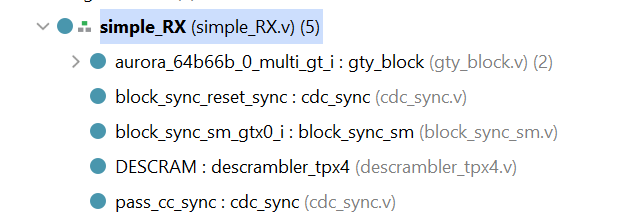

The aurora_64b66b… block is essentially the FPGA’s GTY transceiver “primitive”- the native resource of the FPGA.

#### 64/66b encoding

Each 64b word has a 2b sync header added, which can be either 10 or 01 (depending on whether it is a data word or a control word), thus guaranteeing a transition every 66b. A simple state machine examines the output data words and exercises the RX_GEARBOX_SHIFT control of the GTY receiver to align the output 66b word boundaries such that the sync header is always in the 65:64 bit position. At this point the output data is aligned, and the sync headers are discarded, with 64b data passed to the output. The only control words which are produced are what TP4 calls an IDLE character, but which doesn’t match the IDLE character of Aurora. No matter, all of these control words are suppressed.

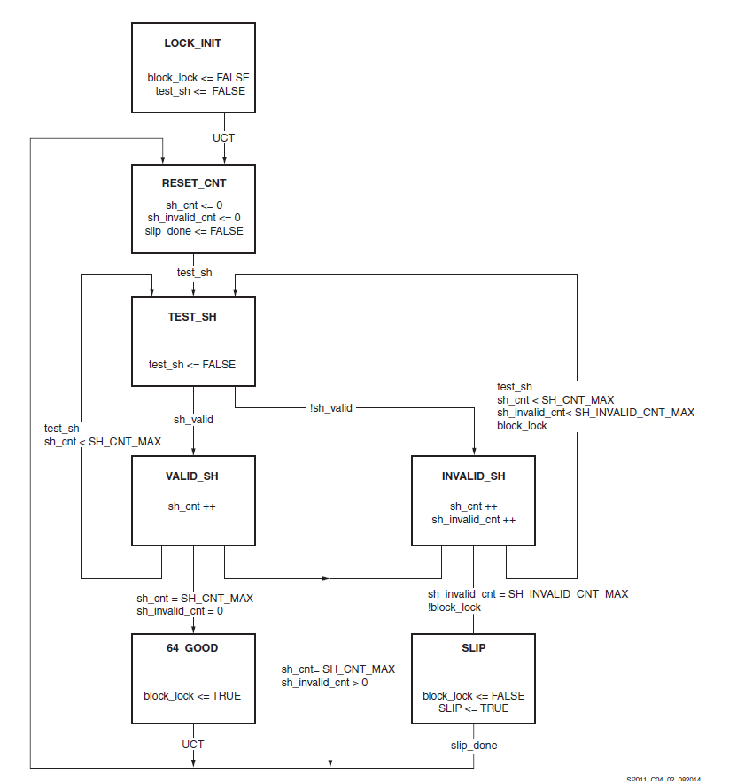

*64/66 Alignment State Machine*

#### 58b Descrambler

The data in the TP4 is scrambled before transmission for two reasons: first, there need to be a sufficient frequency of transitions in the datastream in order for the clock recovery system to work in the receiver. And second, there needs to be an approximate balance of 1s and 0s in the datastream so that the data lines can be ac-coupled into the receiver (a long series of 1s or 0s would otherwise cause baseline drift and disrupt the data reception). The 58b scrambler turns virtually any input stream into an apparently random output stream. This then needs to be descrambled to recover the original data. This process is self-aligning, in that there is no need synchronize the descrambler to the scrambler:

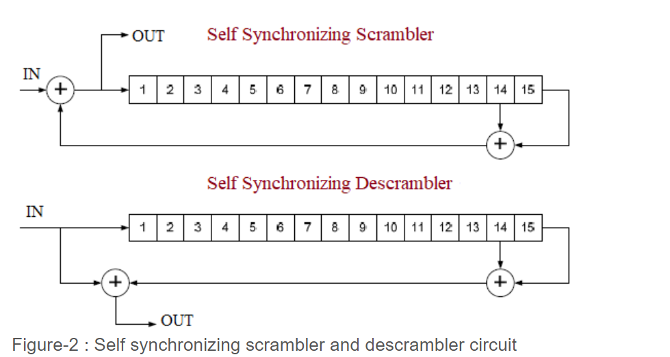

Because of the reversal of the TP4 bit order, the descrambler used in Aurora needs a simple modification:

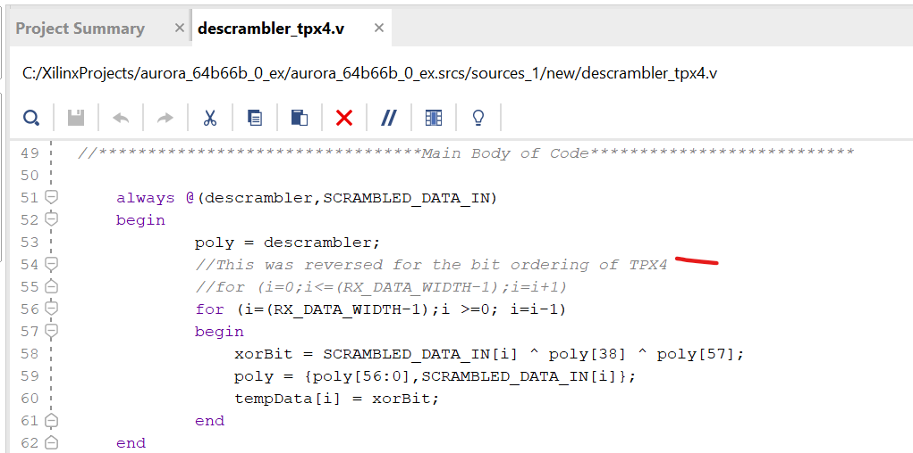

The 64b data out of the scrambler are passed along with a data_valid signal. A “pass_control_characters” control is provided which, if asserted, will cause all of the IDLE words to be passed along to the output data stream. The TP4 outputs these IDLE words constantly in between data words; this could be useful in debug. The output data is synchronous to the rx_usrclk_out signal from the block, at 1.28Gb/sec bit rate these clocks are 20MHz.

In the 1GbE system, the output streams from two of these SimpleRx blocks go through two clock-crossing FIFOs (necessary to cross the clock domain boundaries between the two rx_usrclk_out clocks and the system 100MHz clock) and then are merged using an axis switch and written into a memory-mapped FIFO (all of this is standard Xilinx IP) from which it is read out by the MicroBlaze processor, and formatted into UDP packets.

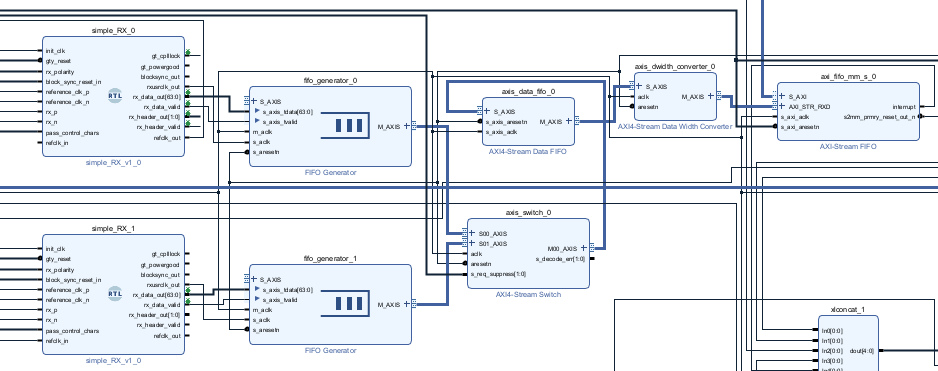

*Science Data Flow in 1GbE system*

### 100GbE system data handling

In the 100GbE system a state-machine based system is used to read out a pair of the SimpleRx blocks, package the data into UDP packets, and pass these to the Xilinx CMAC (hard IP Media Access Controller for 100GbE). The CMAC is connected to one of the QSFP cages on the VCU128. Interface is by 4 GTY pairs (so-called “CAUI-4 mode”), and the transceiver is a 100GBASE-SR4 type (SR for “short reach”, up to 100m of fiber). There are four fibers in each direction, each carrying data at about 26Gb/s.

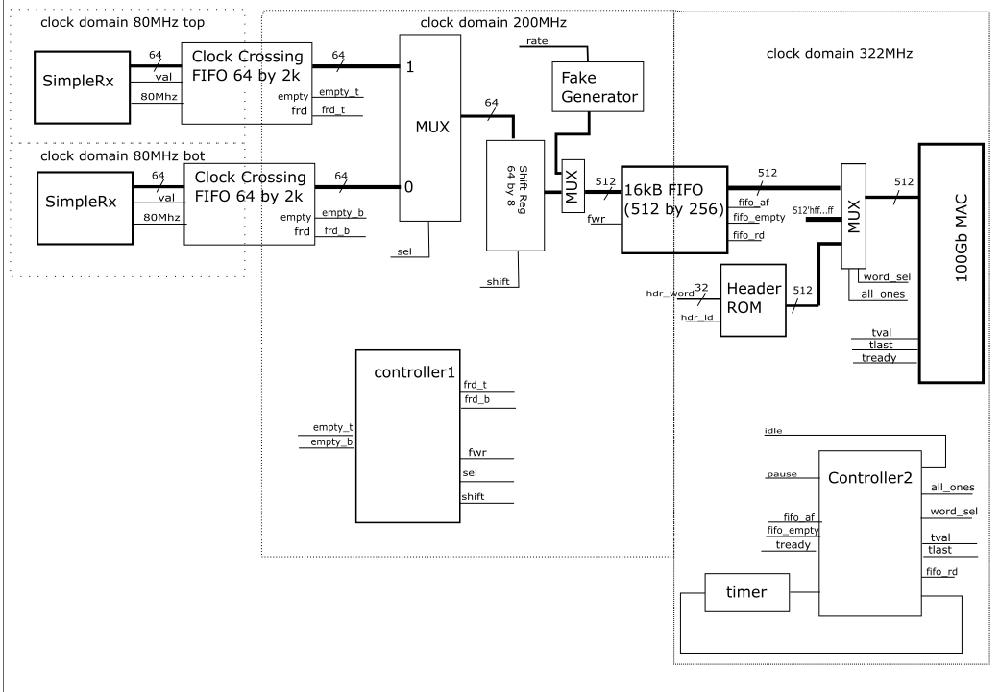

*100GbE system Architecture*

Each SimpleRx block outputs its own clock; at 5.12Gb/s it is 80MHz as shown above. The 100GbE CMAC has an AXIS interface of 512b width operating at 322MHz. The maximum possible data throughput to the CMAC is then 165Gb/s, far in excess of the 103Gb/s line rate of 100Gb Ethernet (there is about 3% overhead related to the 66/64b encoding and the Reed-Solomon Forward Error Correction). The CMAC exerts “back-pressure” to slow down the input data rate to the required speed. I introduced the 200MHz clock domain to make timing closure easier; 200MHz still supports the full 100Gb/s throughput. With just two pairs operating at 5.12Gb/s just 10% of the available output bandwidth is used; with all 16 pairs we can still accomodate the full 16*5.12Gb/s = 82Gb/s. (In fact 160MHz is enough in the middle clock domain).

The output of each SimpleRx is written into a FIFO. A simple state machine controller manages the readout of this pair of FIFOs, reading each one as data becomes available and toggling back and forth as necessary. The 64b output words are accumulated into a 512b word in a shift register. When a complete new 512b word is available it is written into another FIFO which buffers up an entire UDP packet.

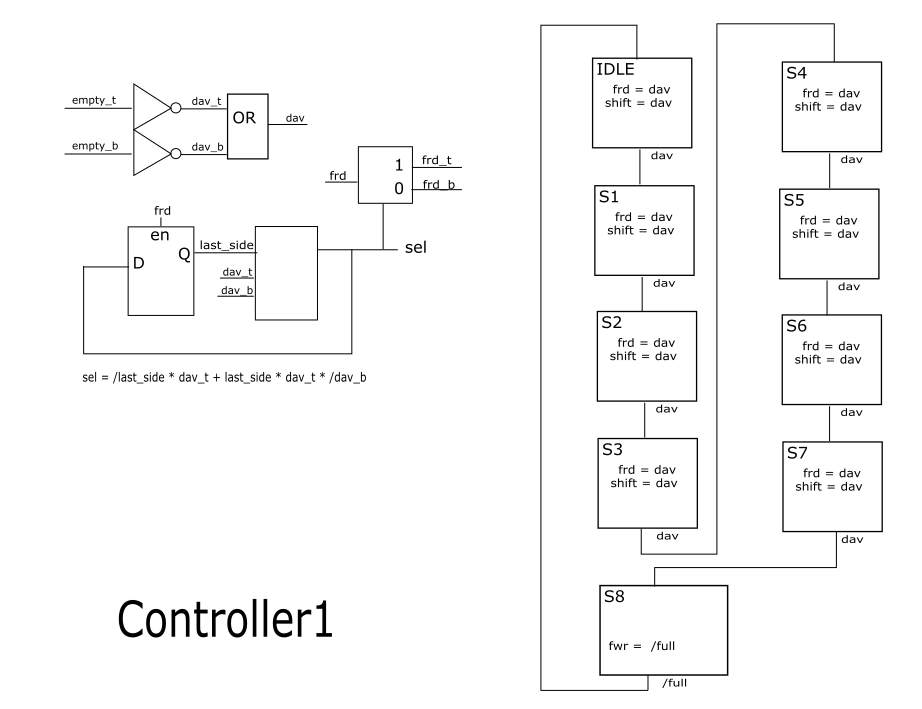

*Controller for reading out the two SimpleRx FIFOs*

A fake data generator producing pseudo-random output words at a software-settable rate allows testing of throughput and data quality.

A second controller is used to write the data words to the CMAC. Each UDP packet is prefaced by 42B of header information: 14 Ethernet header bytes, 20 IP header bytes, and 8 UDP header bytes. These all fit into a single 64B word, the first word of the packet. Four of the remaining 22 bytes of this first word are used for a 16b packet serial number which increments each packet, and an 11b elapsed time counter, incrementing every 203us, which reports the elapsed time since the last science packet was sent.

There is a timer which wraps every ~416ms and forces a packet transmission at low rates. Packets containing fewer than 1112 8B responses are filled with all-one words, so the readout software can skip the rest of the packet when the first such response is encountered.

The header information is fixed since all of the packets are of the same size (8960 bytes including headers). The header information is written at startup by the Microblaze as a series of 15 32b words.

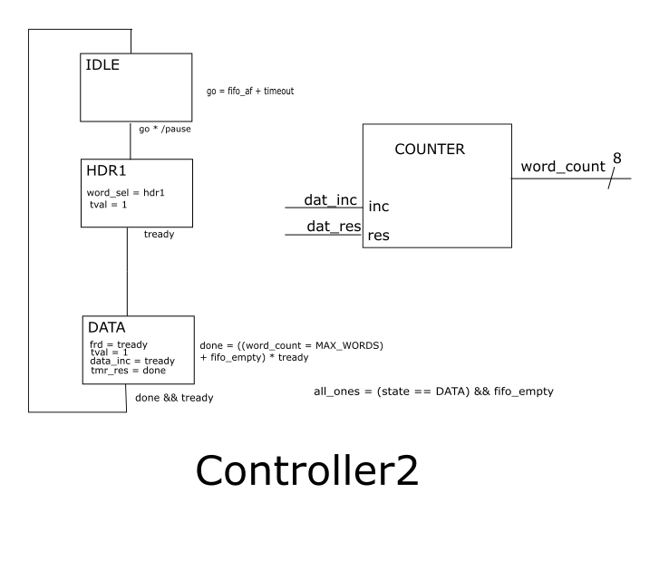

### Fake Data Generator

The system can generate fake data packets at a variable rate by setting the `fake_rate` parameter:

- `fake_rate` = 0, generator off.
- `fake_rate` > 0, output UDP packet rate ~= `fake_rate` \* 5430/sec.

So, for `fake_rate` = 255, that’s 1.38e6 UDP packets/sec of 9000 bytes each, so about 100 Gb/s.

At the maximum setting the output packet rate approximately fills the available 100Gb/s bandwidth. The contents of the packets are a series of LFSR31 values, 64b wide, each repeated 8x.
# Data Formats

The 1GbE interface has a fixed IP address of 192.168.1.10 and expects the host to be at 192.168.1.100. Command and command response packets are written to the system’s UDP port 5001; science packets are written to the host’s UDP port 5001 and housekeeping packets are written to port 5002.

### Science Data Format, 1GbE system

Each UDP science packet payload starts with the identifier byte 0x77 and is followed by N 8-byte data words LSbyte first, for a payload length of 8N+1 bytes and a maximum size of 961 bytes (120 words). Maximum data rate is about 2500 packets/second or 300k pixels/sec. At low rates the system will output a packet every ~ 2 seconds.

### Science Data Format, 100GbE system

Sent to IP address 192.168.4.100, MAC address ff:ff:ff:ff:ff:ff. (There is no ARP functionality, so we use the broadcast MAC address). UDP port 5003, payload size 8918B (so 8960B with 42B of eth, IP, and UDP headers).

A full payload looks like this:

| Payload byte | Contents |
|---|---|
| 0–17 | all zeroes |
| 18–19 | elapsed time, 11b little-endian |
| 20–21 | packet serial #, 16b little-endian |
| 22–29 | ASIC response 0, 64b little-endian |
| 30–37 | ASIC response 1, 64b little-endian |
| … | … |
| 8910–8917 | ASIC response 1111, 64b little-endian |

Total maximum number of TPX4 packets per UDP packet is 1112 = (8918 payload bytes - 22 payload header bytes) / 8

Packets may not always be full, but will always be of the same size. A non-full packet will have the unused part of the packet filled with 0xff, so the software can look for the first 0xffffffffffffffff ASIC response and ignore the rest of the packet.

The format of the 64b ASIC responses is as shown in the TP4 datasheet, Ch 21, e.g.:

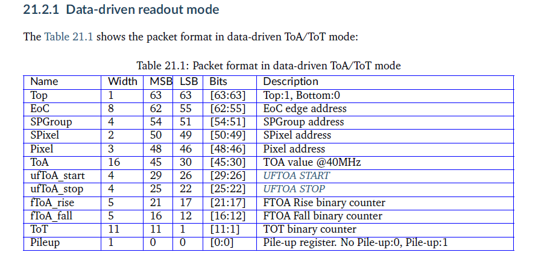

ASIC responses can be either of DATA or of CONTROL/STATUS type, as described in the datasheet.

When the system is operating in “Raw” data mode (using either the design from the “Main” branch of the repo, or using the “Crunched” branch- see below- with all of the data processing switched off), the data packets appearing in the UDP stream will just be a series of ASIC responses, as described above. Interpretation of the packets is done in software in the host computer.

## “Crunched” data flow

In the TP4_1CHIP_CRUNCHED_VCU128 design the raw data is processed to calculate the centroids of event clusters using the IP modules written by Sequent. The design includes software switches to remove the additional computation when it’s desired to look at raw data.  The designs will be kept separate: the use of multiple pairs for each detector half is not consistent with the centroiding logic, since in order to calculate a centroid all of the photon events must be processed in the same centroider.

A block diagram of the additional logic is shown here


The *Rollover* core extends the Time Of Arrival (TOA) data field from 16 bits (at 25ns resolution, 1.64 ms wrap time) to 48 bits (81 day wrap time) so that the cluster-finding algorithm will not be confused by the wrapping of the value (the clustering algorithm seeks to arrange the pixel values in clusters depending on their XY locations and time-of-arrival: pixel events must happen close together in space and time to be considered part of the same cluster). This core also separates out the “Control” packets from the “Pixel” packets, and outputs them in a separate AXIS stream.

The *PixAddr decode* block decodes the raw 18-bit pixel address into a pair of 9b col and row values.

The *G2B decode* block decodes the 16b TOA value from Gray-encoded to binary. We found that the chip misbehaves when GRAY_ENCODE is turned off (and it draws more current, which is expected).

The *TOT_TOA decode* block combines the raw TOA and TOT (Time Over Threshold) values with the fine and microfine TOA values to produce “Complete” values with 195ps resolution.

The *Gain/OS Correct* block performs a TOT’ = TOT\*k1 + k2 linear correction to the TOT values to allow for equalizing slope and offset of the transfer function on a pixel-by-pixel basis.

The *Centroider* block groups the pixel events into clusters and computes the X- and Y-centroid of each cluster.

There are six software switches to control the dataflow:

- `decode_pixadd`
- `decode_gray`
- `decode_tottoa`
- `rollover_on`
- `gain/os_on`
- `centroid_on`

With all of these set to FALSE, the data should flow through unaltered, as described above in [Science Data Format](#science-data-format-100gbe-system). As these switches are set to TRUE, the data format will change.

With `decode_pixadd` = TRUE, the 18b address field will be decoded into 9b col and row values; other data remains unchanged

With `decode_gray` = TRUE, the TOA value will be passed through the Gray-to-binary decoder; data format will not otherwise change.

With `decode_tottoa` = TRUE, the 45 bits of TOA, TOT, fineTOA, microfineTOA data will be combined, per the datasheet conversion formulas, to a pair of “complete” (195ps resolution) TOA and TOT values, with this data format:

```
col[8:0], row[8:0], pileup[0:0], 4'b0000, CTOA[22:0], CTOT[17:0]
```

With `rollover_on` = TRUE, the TOA value will be extended by 32 bits; if `centroid_on` = FALSE, just 4 of the extended bits will be passed on, producing this data format:

```
col[8:0], row[8:0], pileup[0:0], CTOA[26:0], CTOT[17:0]
```

With `gain/os_on` = TRUE, the CTOT value will be transformed by CTOT’ = CTOT\*k1 + k2, with k1, k2 set uniquely for each pixel

With `centroid_on` = TRUE, the Centroider will do its clustering and centroiding, and the output packets will be 128b wide as follows:

```
7'b0, x_div0, y_div0, toa[54:0], num_pixels[15:0], sum_tot[15:0], X[15:0], Y[15:0]
```

Where:

- `x_div0` and `y_div0` are flags indicating a divide-by-zero error in the computation
- `toa[54:0]` is the 55-bit Time Of Arrival value, in 195ps steps
- `num_pixels[15:0]` is the number of pixels included in the centroid computation for that cluster
- `sum_tot[15:0]` is the sum of the CTOT values of the pixels in that cluster (analogous to total charge)
- `X[15:0]` and `Y[15:0]` are the computed coordinates of the centroid of the cluster


## MicroBlaze Software

I compiled the firmware without any off-FPGA RAM (“DDR4”) because I thought the DDR4 was causing a problem with the ethernet communication. Not sure about this at this point, but the design is built without external RAM and so is limited to the 512kB of on-chip BRAM. And this means that the software, which needs the LWIP (Light Weight Internet Protocol) for ethernet communication, must have LWIP stripped down to fit in the available memory. Here are the changes I make:

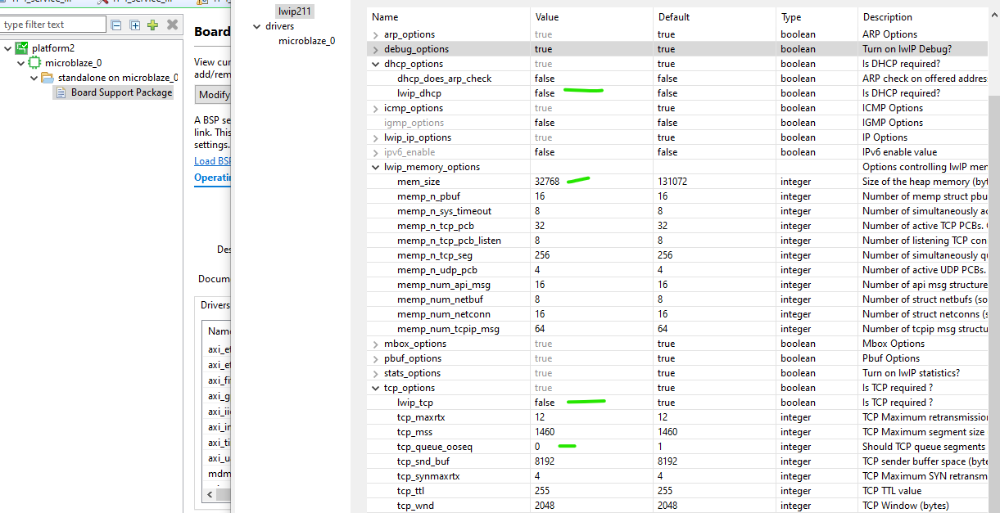

## Setting up 100Gb NIC, etc.

Install the NIC in the PC, and the driver- I installed *MLNX_WinOF2-3_20_50010_All_x64.exe*, though it may work with whatever Windows comes with. The NIC should be set to IPv4 address 192.168.4.100, subnet mask 255:255:255:0, no gateway, no DNS. And set the Jumbo packet size to max:

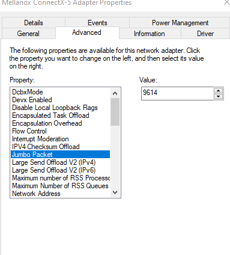

Plug a 100GBASE-SR optical transceiver into the NIC and one into QSFP3 of the VCU128, plug the cable in. Load up the FPGA bitfile (after power cycle this must be done twice and sometimes 3 times to get the 1GbE interface working). You can test the 100GbE interface without any TP4 hardware by using the fake data generator. Send the S1 and K1 commands in `TP4_control.py` (S1 turns science data on, K1 turns fake data on to its lowest rate). Run Wireshark to see the packets:

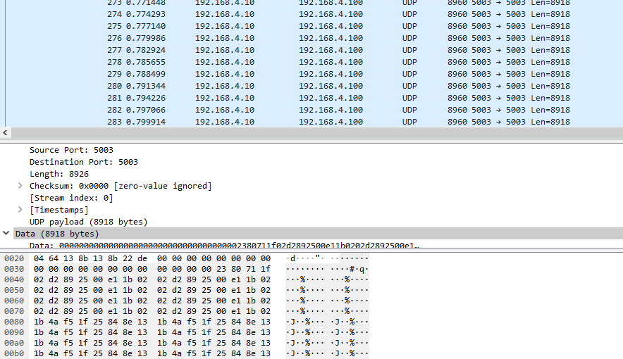

Note that each set of 8B is repeated 8x. We could do a pretty good error rate test just by comparing the 8 values to each other, and a data flow test by looking at the packet serial numbers to note missing packets. In testing with Wireshark I see that the max packet capture rate is about 80,000/sec on my computer (vs 1.4M/s possible at full line rate)

## The > 1.28 Gb/s problem

I was stuck for a long time on the fact that the system worked when compiled for TP4 output bit rate of 1.28Gb/s but not for 2.56 or 5.12. (But see update below.) I implemented In-system Bit Error Rate (IBERT) modules in the FPGA to examine the signal integrity. These use the “native” data- just whatever happens to be coming into the receiver- to plot “eye diagrams”, showing the smearing of the edges of the received data. These looked very clean at 1.28Gb/s:

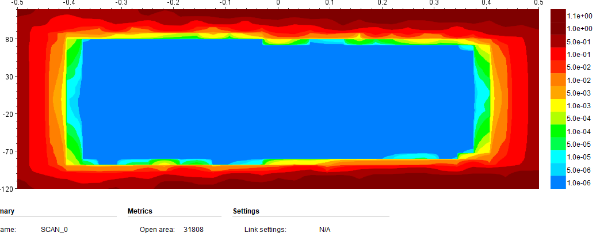

At higher bit rates the IBERTs stopped working because there was no clock being recovered from the data stream. By inserting a lot of ILA (Chipscope) cores I was able to see that at the higher frequencies the low-level GTY receiver module itself was being held in reset, thus preventing any clock recovery or any other function.

In the [SimpleRx](#simplerx) module discussed above there is a Xilinx IP module called GTY_BLOCK_TOP or GTY_BOT:

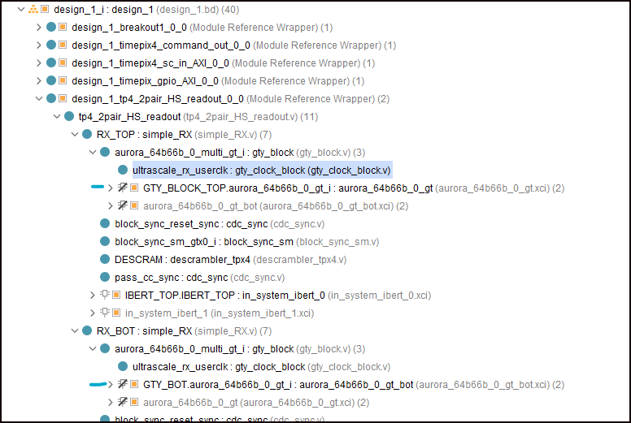

These are generated using the FPGA Transceivers Wizard:

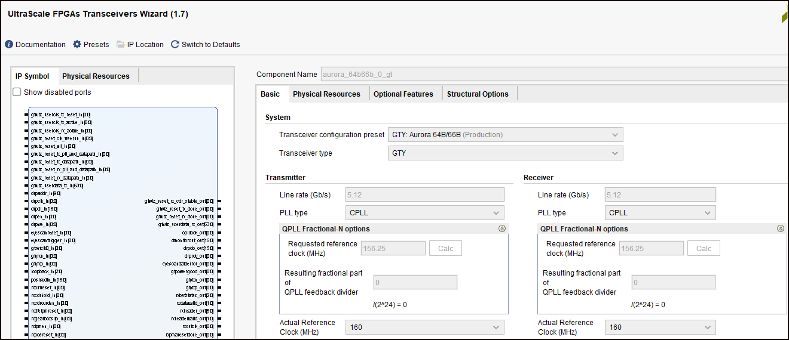

Key parameters here are the 5.12 Gb/s bit rate and the 160MHz reference clock freq. When you generate this module it results in a whole bunch of Verilog HDL files describing all of the stuff that goes around the actual GTY channel primitive (that being the name for the lowest level thing in the FPGA):

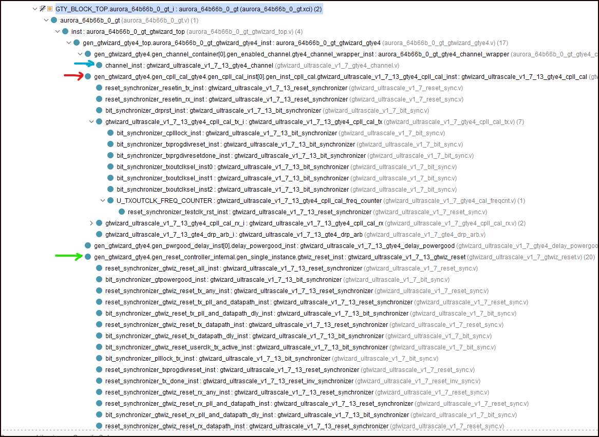

That whole hierarchy is just what is inside of the GTY_BLOCK module. The GTY channel itself is indicated in red, the reset controller in green, the cpll_cal module in red. The receiver has a phase-locked loop called the Channel PLL, CPLL, to multiply the 160MHz reference clock up to the required line rate. In fact at 1.28 Gb/s the CPLL operates at 2.56 GHz and is divided by 2 before being used; at 2.56 and 5.12 it operates at those frequencies. (The PLL being an analog thing, it only has a limited operating range, in this case 2 to 6.5 GHz).

The reset controller sequences several of the reset lines to the GTY channel; it was these that I found were stuck high, preventing any function of the receiver. The cpll_cal module generates a signal called cplllock; this seems to indicate that all is well with the CPLL. This was high for the functioning 1.28 Gb core and low for the 2.56 core. The source code for the cpll_cal module is not very readable being parameterized for a huge number of use cases, and if you synthesize the design and just look at that one module, you see this:

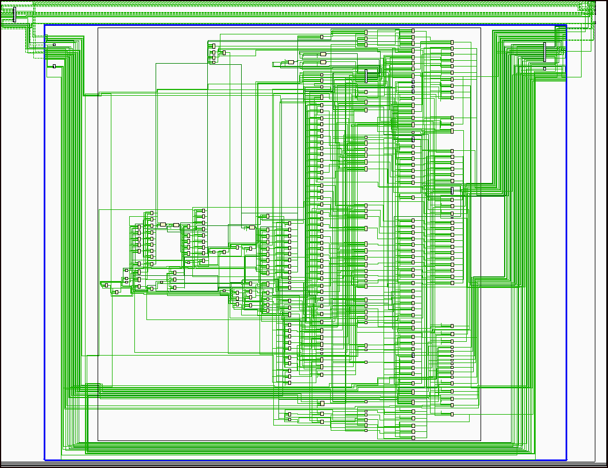

Not sure what this does or why it isn’t doing it, but since the CPLL seems to work fine at 2.56 GHz in the 1.28 Gb/s design it ought to be OK also in the 2.56 Gb/s design. So I decided to just hardwire that cplllock signal high.

In order to edit a Xilinx IP, you need to take it out of the IP control system (you can imagine that it’s not usually good to edit one of the ~50 files that constitute the generated Verilog). You do this by unchecking the “IS_MANAGED” box:

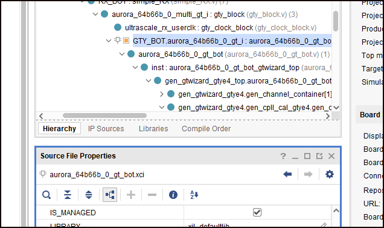

Then you can get in there and edit the HDL. This is the file that needs to be changed- the two indicated lines:

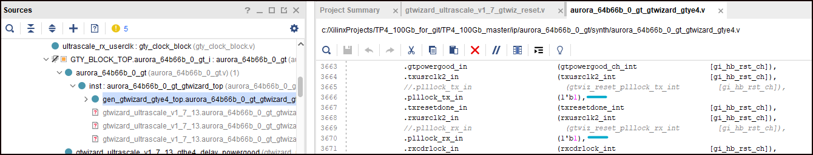

If you want to change something in the IP (bit rate, choice of transceiver, etc) you’d need to check IS_MANAGED, make changes, uncheck IS_MANAGED, generate the IP, then do the edits again

Having done that the design seems to work fine at both 2.56 and 5.12. At 5.12 Gb/s the data eyes still look good:

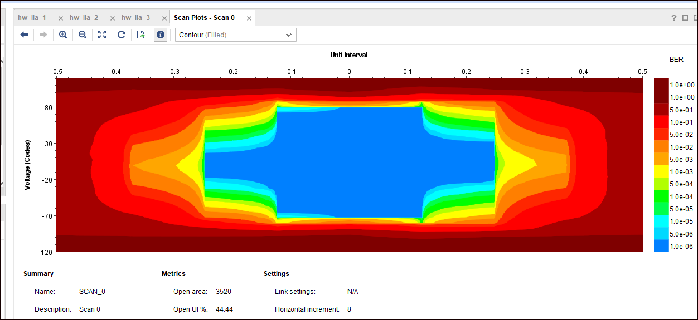

*TOP*

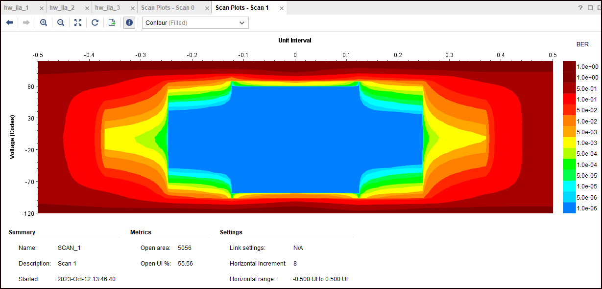

## Update in 2026, using Vivado 2025.2
I was able to recompile the firmware under 2025.2 without doing any of that; the hardware works at 5.12Gb/s even without making these changes.  

